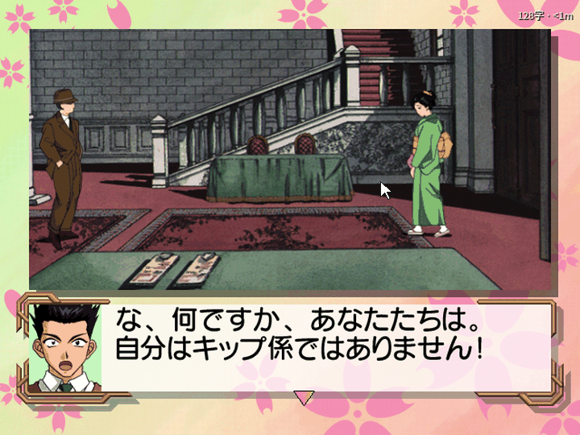
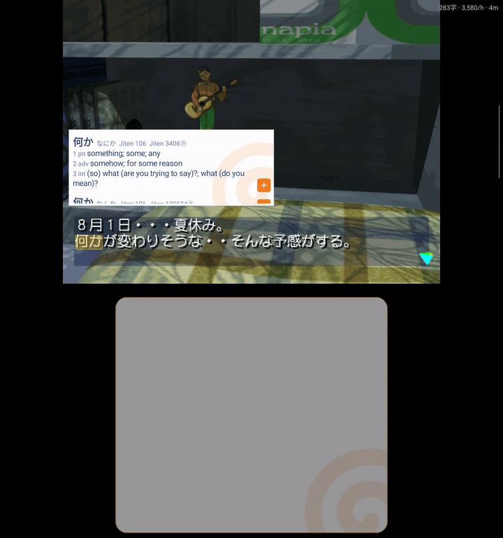
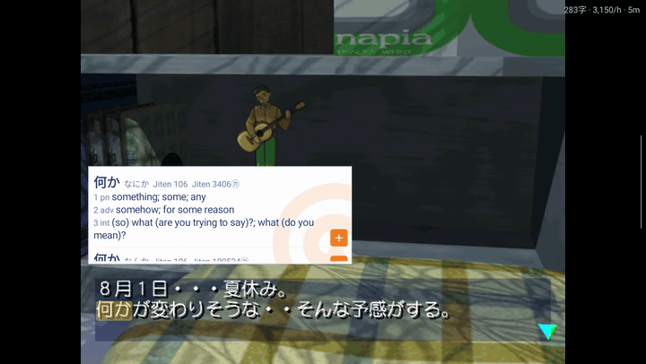
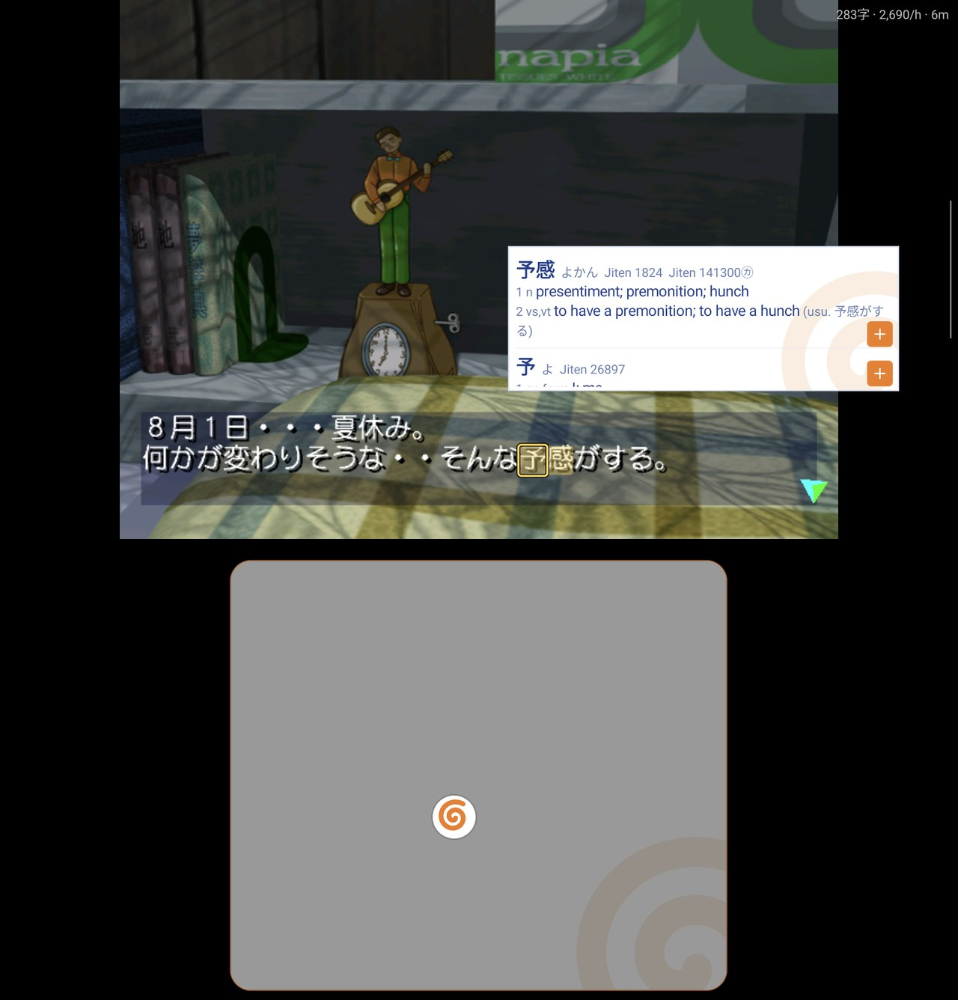
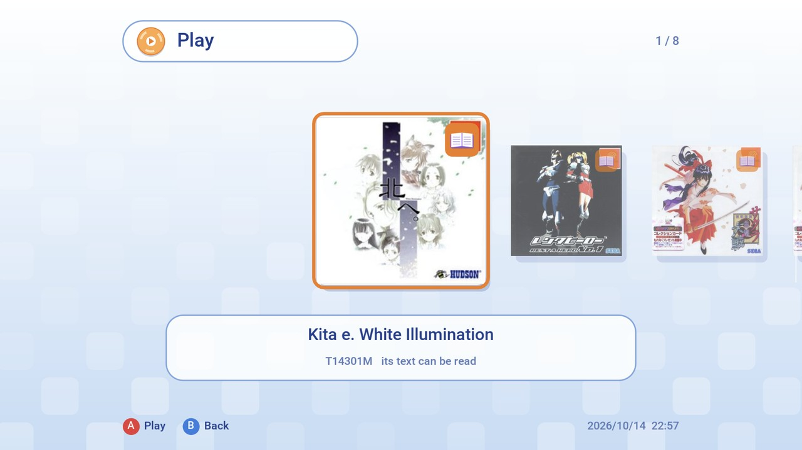
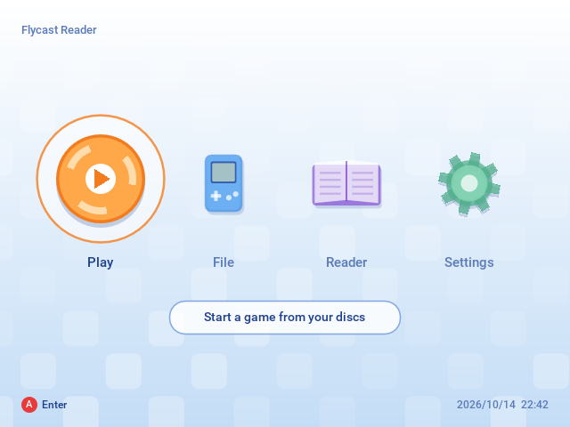
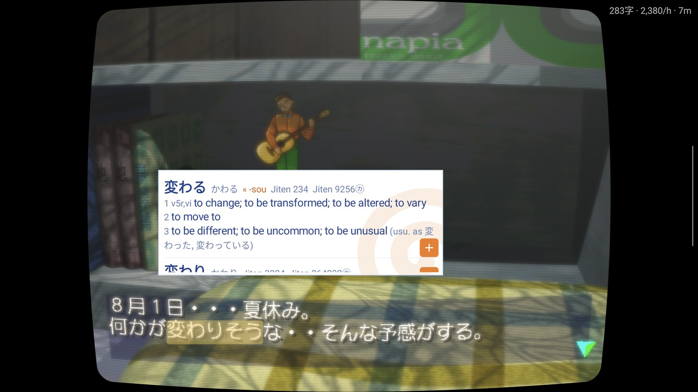

# Flycast Reader

Read Japanese Dreamcast games like a visual novel in a browser with Yomitan: point at a word
in the game's own text and its dictionary entry opens. Make Anki cards, keep a backlog and
reading statistics.

For Windows and Android.

One of four [reader emulators](https://github.com/sommepo/readers) for PS2, PSP and Dreamcast games.

<table>
  <tr>
    <td width="50%"> Windows: point at a word</td>
    <td width="50%"> Android, two screens: the lower one is a trackpad</td>
  </tr>
</table>

> A fork of [Flycast](https://github.com/flyinghead/flycast) v2.7. It is not Flycast: please
> report nothing about it to the Flycast project. Flycast's README is
> [README.flycast.md](README.flycast.md). The reading layer is AI-written.

## Features

- **Look up words in the game's text.** On a computer, point at a word. On Android, move the
  cursor onto it with the controller or, on a two-screen handheld, the lower screen as a
  trackpad. Clicking or touching a word works too. Uses Yomitan dictionaries.
- **The word is outlined, and the outline glides** from word to word as you move along the
  line. Highlight or no mark at all instead, in Reader settings.
- **The popup stands right next to the word** and stays put while you go to its **+**, which
  sits in the bottom left of each entry (or any corner you choose).
- **Anki cards** with the sentence and a picture of the scene.
- **Backlog and reading statistics.**
- **A Dreamcast-style menu** as the main screen.
- **CRT picture** with a tube's frame around it (Reader settings).
- **Play by touch** on a phone: a tap on the picture goes on, a tap on an answer picks it, and
  the controller's buttons stand in a small column at the right edge that a tab tucks away. On
  at first only on a device without controls of its own.
- **Two-screen handhelds** (AYN Thor): the lower screen is a trackpad for the cursor, and the
  controller stays the game's.
- **A Steam Controller's back buttons** are the reader's: pause the game to look words up,
  pause the statistics, make a card, open the backlog.

<table>
  <tr>
    <td width="50%"> A lookup on Windows</td>
    <td width="50%"> Android: touch a word</td>
  </tr>
  <tr>
    <td> Cursor lookup on Android</td>
    <td> Play: a book marks a supported game</td>
  </tr>
  <tr>
    <td> The main menu</td>
    <td> CRT picture</td>
  </tr>
</table>

## Get it

From the [releases](../../releases):

- **Windows**: `FlycastReader-<version>-windows.zip`. Unpack it and start `flycast-reader.exe`.
- **Android**: `FlycastReader-<version>-android.apk` (arm64). Installs beside Flycast.

You need your own games.

## Game scripts

A game is read through a **game script**: a small Lua file that tells the app where the game
keeps its text. The apps install them from the list in this repository: **Game Scripts** on
the menu's Reader page (on Windows also **Reader → Game scripts…**, on Android also in Reader
settings). New games appear there without an app update. You can also install a script from
a file.

| Game | ID | Reads |
| --- | --- | --- |
| シェンムーII | HDR-0164 | Subtitles |
| What's シェンムー 〜湯川(元)専務をさがせ〜 | 6107179 | Subtitles |
| セガガガ | HDR-0151 | Message window |
| レンタヒーロー No.1 | HDR-0074 | Message window, speakers |
| サクラ大戦 | HDR-0072 | Message window, timed choices |
| 北へ。White Illumination | T14301M | Message window |
| 新世紀エヴァンゲリオン 綾波育成計画 | T46303M | Message window |

### Writing a script

A script holds addresses and decoding logic only, never text or data from the game.
[AGENTS.md](AGENTS.md), "Adding a game", explains how a game is run without a display while a
script is written; each game's notes are in [docs/reader/games](docs/reader/games). Pull
requests with new scripts are welcome.

## Building

See [AGENTS.md](AGENTS.md).

## Licence

GPL-2.0, as Flycast ([LICENSE](LICENSE)).
